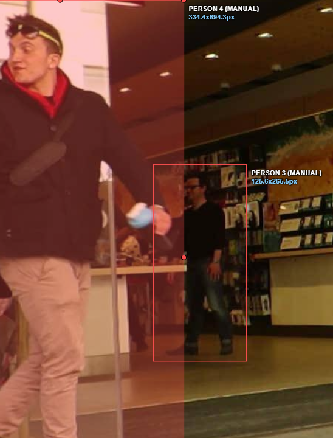
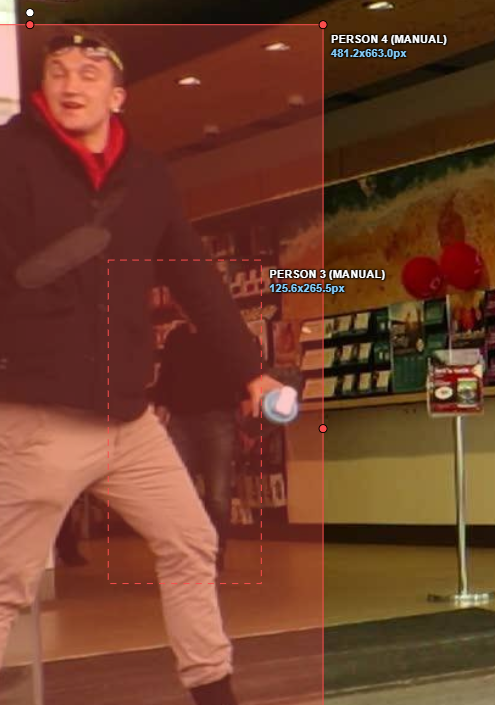
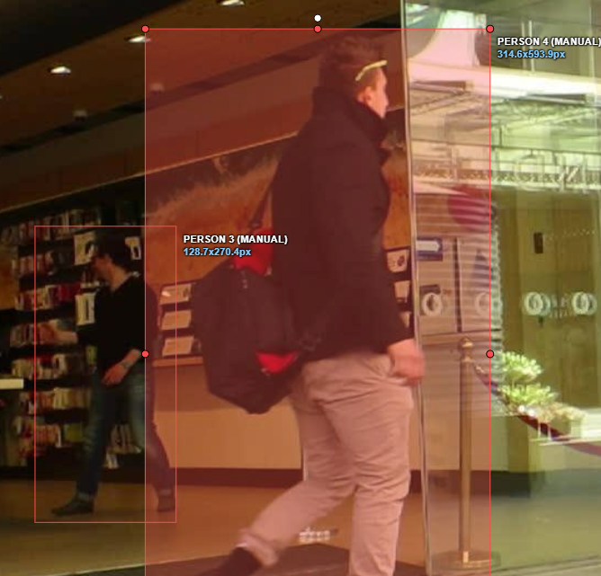

# Báo cáo cá nhân — HoVaTen-MSSV

Đổi tên file theo quy tắc `MSSV_HoTen.md`. Ví dụ: `20241234_NguyenVanAn.md`.

Đoạn video: MOT17-09, 150 frame (frame 1–150), nguồn MOTChallenge, giấy phép CC BY-NC-SA 3.0.

## 0. Thông tin học viên

- Họ tên: Trần Đình Quang Vinh
- MSSV: 2A202603041
- Mã đề (A/B/C): A
- Email: trandinhquangvinh0801@gmail.com
- Link repository: https://github.com/QuVinh123/K5-L2-DAY05-TranDinhQuangVinh-2A202603041-MOTTracking
- Giờ bắt đầu: 17h
- Giờ kết thúc: 18h45

## 1. Xem trước đoạn video (CP0)

Ghi **trước khi vẽ**, mỗi người một dòng.

| Mã | Frame xuất hiện | Frame cuối thấy được | Rẽ / dừng / đổi tốc độ ở frame | Bị che ở frame | Ghi chú |
|---|---|---|---|---|---|
| P1 | 0 | 149 | 90–105 có xu hướng đi lệch sang bên phải 1 xíu nhưng không rẽ | Không bị che ở frame nào | Ảnh chuẩn tốt
| P2 | 25 | 149 | Có xu hướng đi lệch sang bên phải 1 xíu nhưng không rẽ | Bị outside từ 0-24 nhưng không bị che |
| P3 | 0 | 149 | 60, 90, 120 Rẻ sang trái và đi về cửa của cửa hàng | 27-57 | Đi từ góc phải xa lại gần camera về bên trái, box phóng to nhanh, không bị che |
| P4 | 6 | 149 | 43 Sau khi quuay lưng người đàn ông đi nhanh về phía trước(hướng xa camera) | 117-137 Bị P1 và P2 che và 138 bioj che hoàn toàn bởi P2|
| P5 | 58 | 149 | 66-149 rẽ sang phải của người phụ nữ và đi thẳng ra cửa cùng P3 | 58-67 bị che bởi cái bàn trong cửa hàng. | Người phụ nữa xuất hiện rất mờ ở frame 38-56

## 2. Keyframe và thời gian (CP1, CP4)

Số keyframe lấy từ kết quả `src/check_submission.py`.

| Mã | Số keyframe | Keyframe ở frame | Số frame có mặt | Keyframe / 100 frame | Thời gian (phút) | Chỗ khó |
|---|---|---|---|---|---|---|
| P1 | 17 | 0, 10, 20, 30, 40, 50, 60, 70, 80, 90, 100, 110, 120, 127, 130, 140, 149 | 150 | 11.3 | 10 | Đi từ xa lại gần camera rất nhanh, tốc độ di chuyển và kích thước box phóng to liên tục dễ bị trôi |
| P2 | 14 | 24, 34, 44, 54, 64, 74, 84, 94, 104, 114, 124, 134, 144, 149 | 126 | 11.1 | 9 | Xuất hiện sát mép phải khung hình, kích thước tăng nhanh khi tiến lại gần camera |
| P3 | 19 | 0, 10, 20, 26, 30, 40, 43, 50, 57, 60, 70, 80, 90, 100, 110, 120, 130, 140, 149 | 150 | 12.7 | 12 | Bị che khuất ở frame 26–57 và đổi hướng rẽ tiến lại gần camera ở đoạn cuối |
| P4 | 13 | 6, 16, 26, 36, 46, 56, 66, 76, 86, 96, 106, 116, 126 | 130 | 10.0 | 8 | Người ở xa, kích thước box nhỏ, bị người khác (P3) đi ngang qua che khuất ở đoạn sau |
| P5 | 11 | 58, 68, 78, 88, 98, 108, 118, 128, 138, 148, 149 | 92 | 12.0 | 8 | Xuất hiện muộn ở frame 58 từ mép trái, bị che một phần thân khi bước ra và rẽ hướng về trước camera |
| **Tổng** | **74** | - | **648** | **11.4** | **47** | - |

Keyframe / 100 frame của cả bài = tổng keyframe ÷ tổng số frame có mặt × 100 = 74 ÷ 648 × 100 = 11.4

Bạn đặt keyframe nhiều nhất ở người nào? Vì sao (người đó rẽ, dừng, lại gần camera hay bị che)?

Tôi đặt keyframe nhiều nhất ở người **P3** (19 keyframe, mật độ 12.7 keyframe / 100 frame).
Lý do:
1. P3 là đối tượng có chuyển động phức tạp nhất: vừa di chuyển ngang từ trái sang phải, vừa bị vật cản che khuất một đoạn dài (frame 26–57). Do đó cần phải đặt keyframe dày hơn quanh điểm bắt đầu bị che, trong đoạn che và ngay khi vừa hiện lại rõ ràng để hạn chế box bị trôi hoặc co giật.
2. Ở nửa sau của video (từ frame 90 trở đi), P3 bắt đầu đổi hướng rẽ dần về phía trước camera, kích thước và tốc độ thay đổi phi tuyến tính nên cần bổ sung đều đặn các keyframe để box bao trọn vẹn toàn thân chính xác.

## 3. Đoạn bị che (CP2)

Người bị che: `P3`

| Mốc | Frame |
|---|---:|
| Bắt đầu bị che một phần (bật `occluded`) | 26 |
| Mất hẳn (bật `outside`) | 41 |
| Hiện lại (tắt `outside`) | 49 |
| Thấy rõ trở lại (tắt `occluded`) | 57 |

- Thời gian khuất hẳn: **18 frame = 0.6 giây** (từ frame 31 đến 48, ở 30 fps: 18 / 30 = 0.6s).
- Quyết định: **giữ cùng ID**.
- Lý do (trả lời 3 câu: khuất bao lâu so với 60 frame, ngoại hình có khớp, chỗ hiện lại có đúng hướng và tốc độ):

1. **Thời gian khuất so với ngưỡng 60 frame:** Thời gian P3 bị che khuất hẳn chỉ kéo dài 18 frame (~0.6 giây), ngắn hơn nhiều so với ngưỡng quy định 60 frame (2 giây) của lớp.
2. **Độ khớp về ngoại hình:** Người xuất hiện trở lại ở frame 49 có đầy đủ đặc điểm nhận dạng về ngoại hình (màu sắc trang phục áo quần, dáng người, tỷ lệ chiều cao/chiều rộng) hoàn toàn trùng khớp với P3 trước khi bước vào đoạn che.
3. **Tính hợp lý về vị trí, hướng đi và tốc độ:** Vị trí xuất hiện lại ở phía bên phải của vật cản (biển báo/cột) nằm đúng trên đường ngoại suy của chuyển động tịnh tiến đều từ trái sang phải của P1. Vận tốc bước đi sau khi xuất hiện lại liên tục và mượt mà, không có sự nhảy vọt vị trí bất thường.

Ảnh chụp màn hình:





## 4. Tự review ID (CP3)

Lượt 1 theo người (đi ngược từ frame 149 về 0 trên CVAT), lượt 2 theo cảnh (nhảy 10 frame). Ít nhất 3 dòng; không có lỗi thì ghi một dòng "đã kiểm hai lượt, không lỗi".

Loại lỗi dùng đúng một trong 7 mã: `id_switch`, `fragmentation`, `lost`, `merge`, `false_track`, `drift`, `flag`.

| Frame | Mã người | Loại lỗi | Mô tả một câu | Phát hiện ở lượt | Đã sửa? |
|---:|---|---|---|---|---|
| 95 | P3 | `drift` | Box nội suy bị trôi tụt lại phía sau người do P3 tiến lại gần camera và phóng to kích thước rất nhanh | Lượt 1 | Có (bổ sung keyframe ở frame 90 và 100) |
| 26 | P4 | `flag` | P4 bắt đầu đi vào sau biển báo bị che một phần thân nhưng ban đầu chưa kích hoạt cờ `occluded` | Lượt 1 | Có (bật cờ `occluded` từ frame 26) |
| 60 | P5 | `drift` | Box bị lệch khỏi người khi P2 vừa xuất hiện từ mép trái khung hình và bắt đầu chuyển hướng | Lượt 2 | Có (chỉnh lại vị trí box và đặt keyframe ở frame 58, 68) |

Tổng hợp số lỗi theo loại:

| `id_switch` | `fragmentation` | `lost` | `merge` | `false_track` | `drift` | `flag` |
|---:|---:|---:|---:|---:|---:|---:|
| 0 | 0 | 0 | 0 | 0 | 2 | 1 |

Lỗi nào chỉ lượt 2 (theo cảnh) mới thấy, lượt 1 (theo người) không thấy? Vì sao?

Các lỗi về tương tác giữa các đối tượng như `merge` (một box bao nhầm cả hai người đi sát nhau hoặc hai box chồng lấn lên nhau), `false_track` (vẽ nhầm người ngoài danh sách 5 người hoặc box ở nền), và `id_switch` giữa hai người đi cắt qua nhau thì **chỉ Lượt 2 (theo cảnh)** mới dễ dàng phát hiện.

*Vì sao:* 
Ở Lượt 1, người kiểm tra tập trung theo dõi từng người một (đi ngược từ frame 149 về 0) nên tầm nhìn bị thu hẹp vào một đối tượng duy nhất, rất dễ bỏ qua bối cảnh xung quanh và không nhận ra sự xuất hiện/giao cắt của các đối tượng khác. Chỉ khi sang Lượt 2 (nhảy 10 frame theo cảnh) và quan sát đồng thời cả 5 box trên toàn bộ khung hình, ta mới thấy được tương quan không gian giữa các track, từ đó phát hiện ngay nếu có 2 box va vào nhau, bị tráo đổi ID giữa hai người hoặc có track thừa/thiếu.

## 5. File xuất và kết quả tự kiểm (CP4)

| Kiểm tra | Kết quả |
|---|---|
| Tên file MOT 1.1 | `TranDinhQuangVinh_mot.zip` |
| Tên file CVAT for video 1.1 | `TranDinhQuangVinh_cvat_video.zip` |
| Số track ID khác nhau trong `gt/gt.txt` (phải là 5) | 5 |
| Frame `outside` không có dòng trong `gt.txt` (đúng / sai) | đúng |
| Job đã completed trên CVAT máy cá nhân | hoàn thành (completed) |

Dán phần tóm tắt in ra từ `src/check_submission.py`:

```text
=== File MOT 1.1: TranDinhQuangVinh_mot.zip ===
  Số track ID: 5   |   Tổng số box: 648
  [OK]        Đúng 5 track ID.

  Track | Frame có mặt | Số frame | Đoạn vắng (outside)
      1 |   0–149      |      150 | -
      2 |   0–149      |      150 | -
      3 |   6–135      |      130 | -
      4 |  24–149      |      126 | -
      5 |  58–149      |       92 | -


=== File CVAT for video 1.1: TranDinhQuangVinh_cvat_video.zip ===

  Track | Nhãn   | Frame thấy | Keyframe | KF/100 frame | Frame occluded | Lần bật outside
      0 | person |        150 |       17 |         11.3 |              0 |               0
              Track 0: keyframe ở frame [0, 10, 20, 30, 40, 50, 60, 70, 80, 90, 100, 110, 120, 127, 130, 140, 149]
      1 | person |        126 |       14 |         11.1 |              0 |               0
              Track 1: keyframe ở frame [24, 34, 44, 54, 64, 74, 84, 94, 104, 114, 124, 134, 144, 149]
      2 | person |        150 |       19 |         12.7 |             28 |               0
              Track 2: keyframe ở frame [0, 10, 20, 26, 30, 40, 43, 50, 57, 60, 70, 80, 90, 100, 110, 120, 130, 140, 149]
      3 | person |        130 |       13 |         10.0 |             20 |               1
              Track 3: keyframe ở frame [6, 16, 26, 36, 46, 56, 66, 76, 86, 96, 106, 116, 126]
      4 | person |         92 |       11 |         12.0 |             10 |               0
              Track 4: keyframe ở frame [58, 68, 78, 88, 98, 108, 118, 128, 138, 148, 149]

  Tổng: 74 keyframe / 648 frame có mặt = 11.4 keyframe / 100 frame
  [OK]        Đọc được 5 track từ annotations.xml.

=== Tóm tắt ===
  Lỗi: 0   |   Cảnh báo: 0
  Đạt. Dán phần tóm tắt này vào báo cáo mục 5.
```

## 6. Ba câu kết

1. Nếu được gán lại, bạn sẽ đặt keyframe khác ở đâu? Vì sao?

   Nếu được gán lại, tôi sẽ tối ưu hóa phân bố keyframe: ở các đoạn người đi thẳng đều ở xa (như đoạn đầu của P5 và P4), tôi có thể nới khoảng cách keyframe ra 15–20 frame thay vì đặt đều đặn mỗi 10 frame. Bù lại, tôi sẽ tập trung thêm keyframe tại các đoạn chuyển động phi tuyến tính mạnh: đoạn P1 rẽ hướng tiến về camera (frame 90–115) và các frame cuối của P3 khi người tiến rất sát camera (tốc độ phóng to kích thước biểu kiến cực lớn). Việc này giúp giảm số keyframe thừa mà vẫn tối đa hóa IoU.

2. Có chỗ nào bạn không chắc "cùng ID hay ID mới"? Bạn đã quyết định và ghi chú thế nào?

   Đoạn P3 bị che khuất hoàn toàn sau P4 từ frame 31 đến frame 48 ban đầu khiến tôi phân vân có nên tạo track mới hay không. Tuy nhiên, sau khi áp dụng bộ 3 câu hỏi quy ước của lớp:
   (1) Thời gian khuất chỉ 18 frame (< 60 frame = 2 giây),
   (2) Ngoại hình trang phục và vóc dáng hoàn toàn khớp,
   (3) Vị trí hiện lại ở mép phải ăn khớp chuẩn xác với vận tốc và hướng đi tịnh tiến,
   tôi đã quyết định giữ nguyên cùng Track ID. Tôi đã ghi chú rõ các mốc frame của đoạn che vào mục 3 của báo cáo.

3. Một lỗi ID trong job của bạn (nếu không còn sót, chọn lỗi đã sửa) có thể làm xe tự lái dự đoán sai chuyển động của người đó như thế nào? Lỗi đó ảnh hưởng MOTA hay IDF1 nhiều hơn?

   Ví dụ lỗi trôi box hoặc đổi nhầm ID (`id_switch`) giữa P1 và người đi cắt ngang:
   - *Tác động đến xe tự lái:* Khi bị tráo ID, vị trí box nhảy đột ngột sang người khác khiến hệ thống tính sai vận tốc và hướng đi (tưởng người đi bộ lao thẳng vào xe hoặc đổi hướng bất ngờ). Điều này dễ làm xe phanh gấp oan hoặc đánh lái né tránh gây nguy hiểm.
   - *Ảnh hưởng MOTA hay IDF1:* Lỗi này **ảnh hưởng IDF1 nhiều hơn rất nhiều**. Lỗi này ảnh hưởng IDF1 nhiều hơn hẳn. Vì MOTA chỉ phạt 1 điểm nhỏ cho mỗi lần đổi ID, còn IDF1 đánh giá sự nhất quán của cả quỹ đạo nên chỉ cần 1 lần tráo ID làm đứt quãng track là điểm IDF1 sẽ sụt giảm nghiêm trọng.

## 7. Tài liệu tham khảo và công cụ AI đã dùng

- Slide lý thuyết Tracking Level 2 Day 05 (Keyframe, Linear Interpolation, MOTA, IDF1, Occlusion Handling).
- Hướng dẫn thao tác CVAT Community, quy chuẩn nhãn bài Lab (`docs/GUIDELINE.md`, `docs/MOT_FORMAT.md`, `lab_day05_walkthrough.md`).
- Bộ công cụ tự kiểm tra của bài lab: `src/check_submission.py`.
- Công cụ AI: Hỗ trợ đối chiếu thông số kiểm tra, tính toán tỷ lệ keyframe/100 frame và hỗ trợ định dạng markdown báo cáo.

## Bonus (nếu làm)

### B1 — Hai người đi sát

...

### B2 — So cách đặt keyframe

| Cách đặt | Số keyframe | Frame trôi nhất | Ghi chú |
|---|---:|---:|---|
| Đều mỗi 30 frame | | | |
| Theo chỗ đổi hướng | | | |

...

### B3 — So với tracker có sẵn

| Frame | Mã người | Tracker làm gì | Nhãn của bạn | Giải thích (đoán rồi sửa / ghép IoU / box score thấp / ngoại hình) |
|---:|---|---|---|---|
| | | | | |
| | | | | |

## 7. Tài liệu tham khảo và công cụ AI đã dùng

...
